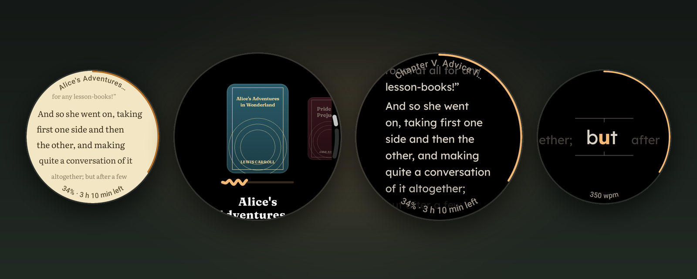
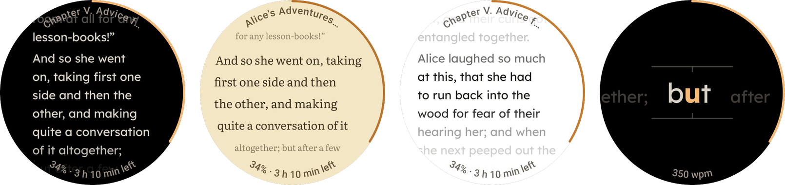

<p align="center">
  
</p>

# Wristrature

[](https://github.com/Caden-H/Wristrature/actions/workflows/ci.yml)
[](LICENSE)


Wristrature is an EPUB reader that runs on the watch itself. It downloads books from your own OPDS library and syncs your
reading position with KOReader. It targets the Pixel Watch 3 and uses Material 3 Expressive.

A book is one continuous scroll that you move with the crown, laid out for a round screen. The app needs no phone
companion and no account, and it contacts only the servers you enter.

## Screenshots

<p align="center">
  
</p>

<p align="center">
  
</p>

## Features

**Reading**

- Chapters run together as a single scroll, with no page breaks.
- Three layouts for a round screen: column, edge-hugging and focus band.
- Four fonts (Lexend, Literata, Fraunces, Atkinson Hyperlegible), four backgrounds, five app palettes, automatic day and
  night colors, and adjustable margins and fade.
- Two curved info lines and an arc along the edge. Each can show the chapter, book title, percent, time left, clock or
  battery.
- Auto scroll at a set number of words per minute, and a speed-reading mode that shows one word at a time with the focus
  letter fixed in the middle. Each book remembers its speeds.
- Contents, jump to a percent (two decimals), bookmarks that show on the page, and a "go back" that retraces your jumps.
- Crown, touch, tap, and the Pixel Watch gestures (double pinch for the next page, wrist turn for the previous one).
  A double tap can add a bookmark, open the menu, start auto scroll, switch day and night or cycle the layout.
- Ambient mode shows a dim black page. A setting reduces motion.

**Library and sync**

- Browse any OPDS 1.x catalog (Calibre-Web-Automated, Calibre, Kavita and others): categories, authors, series, search,
  download. From a book on the watch you can jump to more by the same author or in the same series.
- Reading position sync that is compatible with KOReader and its sync servers, down to the character. The library server
  and the sync server are separate settings. See [docs/sync.md](docs/sync.md).
- A screen that compares the server's place with the watch's and lets you take or send either.
- You can also copy books to the watch with `adb push`. A public-domain demo book is included.

**Around the app**

- A tile and two complications that continue the book you read last.
- The background is black by default, nothing polls in the background, and the screen redraws only when something moves.

## Requirements

- A watch running Wear OS 6 or later (API 36+). Developed on a Pixel Watch 3.
- Optional: an OPDS catalog for books and a KOReader-compatible sync server for your position.

## Install

Every push is built by GitHub Actions. Download the `Wristrature-release-apk` artifact from the latest run on the
**Actions** tab (or the APK attached to a release) and install it with ADB. Use the release build on the watch; debug
Compose builds are several times slower.

1. On the watch open **Settings > System > About > Versions** and tap **Build number** seven times.
2. In **Developer options** turn on **ADB debugging** and **Wireless debugging**, on the same Wi-Fi as your computer.
3. In **Wireless debugging** choose **Pair new device** and note the address, port and code.

```sh
adb pair WATCH_IP:PAIRING_PORT
adb connect WATCH_IP:PORT
adb install -r app-release.apk
```

The release and debug builds are signed with the debug key that is committed in `keystore/` (it protects nothing), so any
build replaces any other with `adb install -r` and keeps your data.

## Setting up

**Library server.** Settings > Library server. Enter the OPDS address (for Calibre-Web-Automated this is
`https://your-host/opds`) and, if needed, a user and password. Plain `http` is accepted with a warning.

**Sync server.** Settings > Sync server. The official KOReader server is the default. Choose *Custom server* for your
own. The same account must be used on every device. For KOReader to match books across devices, they must have the same
file, so download from the catalog on each device. If a book is edited on the server, download it again.

**Without servers.** Copy EPUB files to the watch and add them from Settings > Storage:

```sh
adb push book.epub /sdcard/Android/data/io.github.cadenh.wristrature/files/import/
```

## Controls

| Input | Action |
| --- | --- |
| Tap | Scroll one screen. A tap in the top strip scrolls back. |
| Hold | Open the reader menu. Settings can swap tap and hold. |
| Crown | Scroll. While auto scroll or speed reading runs, the crown changes the speed. |
| Double pinch / wrist turn | Next page / previous page. Double pinch pauses auto scroll. |
| Double tap | Optional action, chosen in Settings > Controls. |
| Hold "Sync now" | Compare and exchange places with the sync server. |

## Building from source

JDK 21 and the Android SDK are required. `tools/setup-sdk.sh` installs the SDK on Linux.

```sh
tools/setup-sdk.sh                              # once; writes local.properties
./gradlew :core:test :app:testDebugUnitTest     # unit and screenshot tests
./gradlew :app:lintRelease                      # lint
./gradlew :app:assembleRelease                  # app/build/outputs/apk/release/app-release.apk
./gradlew :app:recordRoborazziDebug             # re-record the reference screenshots
```

## Project layout

| Path | Contents |
| --- | --- |
| `core/` | Kotlin/JVM library: EPUB import, reading positions, KOReader sync, OPDS, speed-reading pacing. |
| `app/` | The Wear OS app. |
| `docs/` | [Architecture](docs/architecture.md) and [sync](docs/sync.md) notes. |
| `tools/` | SDK setup and a script that builds the pictures in this README. |

## Roadmap

- Links and footnotes from the text
- Search in a book
- Highlights and notes
- Dictionary lookup
- A bundled font picker for your own font files

## License

Apache License 2.0, see [LICENSE](LICENSE). The fonts are under the SIL Open Font License; see
[THIRD_PARTY.md](THIRD_PARTY.md) for them and for the other third-party material.
